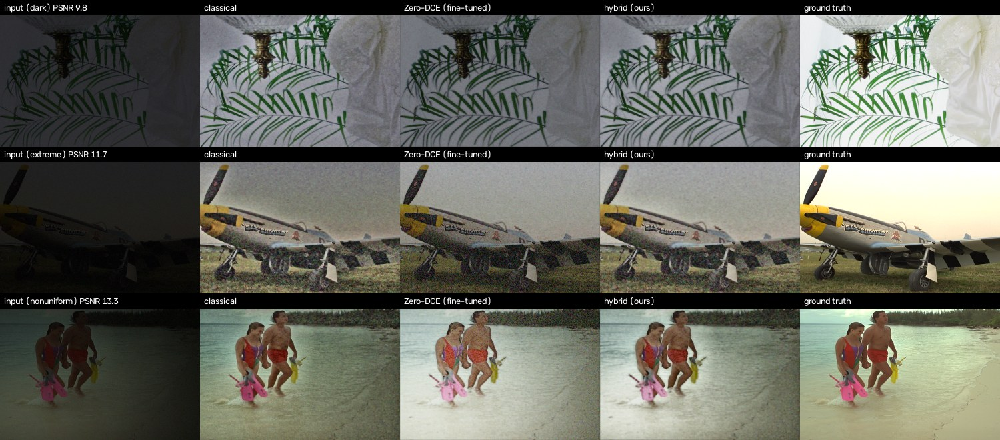

# Ablation Study and Failure Analysis – P1

## 1. Ablation study (official LOL-v2 Real test, 100 pairs)

We switch off one part at a time and run the same 100 unseen test pairs. NIQE is measured
on 26 real dark photos without ground truth. Source: `results/ablation_lolv2_real.csv`,
made by `python scripts/ablation.py --test_dir LOL-v2/Real_captured/Test --name lolv2_real`.

### Hybrid pipeline

| Variant | PSNR ↑ | SSIM ↑ | ΔE2000 ↓ | Edge corr ↑ | Over-exp % ↓ | NIQE real ↓ |
|---|---|---|---|---|---|---|
| **Hybrid full** | 19.63 | 0.761 | 12.99 | 0.865 | 0.000 | 4.76 |
| without adaptive parameters (fixed values) | 19.33 | 0.741 | 12.47 | 0.856 | 0.006 | 4.61 |
| without pre-gain | 19.36 | 0.759 | 12.92 | 0.877 | 0.000 | 4.81 |
| without fusion (Zero-DCE branch only) | 13.91 | 0.618 | 23.78 | 0.759 | 0.000 | 4.76 |
| fusion replaced by fixed 50/50 average | 18.01 | 0.715 | 15.71 | 0.844 | 0.000 | 4.68 |
| without denoising | 18.04 | 0.497 | 14.90 | 0.815 | 0.000 | 4.87 |
| without CLAHE | 20.29 | 0.784 | 12.23 | 0.868 | 0.000 | 4.80 |
| without colour correction | 19.45 | 0.760 | 13.36 | 0.866 | 0.024 | 4.74 |
| original Zero-DCE weights (no fine-tuning) | 19.67 | 0.762 | 12.23 | 0.874 | 0.000 | 4.67 |

### Classical pipeline

| Variant | PSNR ↑ | SSIM ↑ | ΔE2000 ↓ | Edge corr ↑ | NIQE real ↓ |
|---|---|---|---|---|---|
| **Classical full** | 18.02 | 0.673 | 13.45 | 0.852 | 4.55 |
| Retinex replaced by global gamma | 18.86 | 0.755 | 12.79 | 0.827 | 4.46 |
| without adaptive parameters | 17.25 | 0.623 | 13.40 | 0.833 | 4.41 |
| without denoising | 16.34 | 0.407 | 15.99 | 0.777 | 4.82 |
| without CLAHE | 19.39 | 0.766 | 12.60 | 0.873 | 4.73 |

### What we learn

1. **Fusion is the most important part.** Zero-DCE alone is 5.73 dB worse, and a plain
   50/50 average is 1.62 dB worse. So the per-pixel weight from the illumination map does
   real work: dark regions take the Retinex result, lit regions take Zero-DCE.
2. **Denoising matters most for structure.** Without it SSIM drops from 0.761 to 0.497.
   Brightening a dark photo makes its noise just as much bigger.
3. **Adaptive parameters and pre-gain help a little** (−0.30 and −0.27 dB when removed).
   Fixed parameters also let some pixels clip to white.
4. **CLAHE: what validation chose vs what test shows.** Removing CLAHE completely would give
   +0.66 dB on the test set. We did not remove it because of that. We put CLAHE strength into
   the validation tuning: on the 158 validation pairs, the light setting (0.35) scored best
   on PSNR (14.72 dB, against 14.44 with CLAHE off), so that is what we use. Choosing it from
   the test set would be overfitting to the test set. LOL's reference photos are smooth and
   evenly lit, so extra local contrast counts as an error, which is why test prefers less.
5. **Global gamma beats Retinex on PSNR/SSIM in the classical pipeline** (18.86 vs 18.02 dB)
   but keeps edges worse (0.827 vs 0.852). LOL's reference photos look like a simple global
   brightening, and Retinex brightens shadows more than lit areas. Inside the hybrid the
   Retinex branch is still useful, because it is what fixes Zero-DCE's darkest regions.
6. **Fine-tuning did not help the hybrid on LOL-v2 Real** (19.63 vs 19.67 dB with the
   original weights). See failure 1 below.

### Earlier study on our own darkened photos (Kodak24 + McMaster, 126 pairs)

This was run before we had the official data, with our first fine-tuned weights and the
first fusion setting (t_high = 0.3, CLAHE 0.7). Source: `results/ablation.csv`.

#### Hybrid pipeline

| Variant | PSNR ↑ | SSIM ↑ | ΔE2000 ↓ | Edge corr ↑ | Over-exp % ↓ | NIQE real ↓ |
|---|---|---|---|---|---|---|
| **Hybrid full** | **17.66** | 0.569 | 12.68 | 0.763 | 0.0001 | 4.49 |
| without adaptive parameters (fixed values) | 16.31 | 0.506 | 15.30 | 0.703 | 0.0093 | 4.53 |
| without pre-gain | 17.63 | 0.582 | 12.73 | 0.776 | 0.0003 | 4.50 |
| without fusion (Zero-DCE branch only) | 15.82 | 0.488 | 15.43 | 0.677 | 0.0000 | 4.70 |
| fusion replaced by fixed 50/50 average | 17.33 | 0.543 | 13.13 | 0.732 | 0.0000 | 4.62 |
| without denoising | 15.29 | 0.357 | 19.75 | 0.609 | 0.0000 | 4.53 |
| without CLAHE | 17.54 | 0.590 | 13.25 | 0.780 | 0.0000 | 4.61 |
| without colour correction | 17.78 | 0.571 | 12.43 | 0.763 | 0.0169 | 4.46 |
| without fine-tuning (original Zero-DCE weights) | 17.44 | 0.576 | 12.92 | 0.760 | 0.0000 | 4.59 |

#### Classical pipeline

| Variant | PSNR ↑ | SSIM ↑ | ΔE2000 ↓ | Edge corr ↑ | NIQE real ↓ |
|---|---|---|---|---|---|
| **Classical full** | **17.09** | 0.562 | **13.14** | 0.759 | 4.55 |
| Retinex replaced by global gamma | 16.09 | 0.508 | 15.02 | 0.566 | 4.46 |
| without adaptive parameters | 15.59 | 0.486 | 15.90 | 0.689 | 4.41 |
| without denoising | 14.81 | 0.341 | 20.22 | 0.592 | 4.82 |
| without CLAHE | 15.93 | 0.578 | 15.02 | 0.787 | 4.73 |

#### What we learned there

1. **Denoising matters most.** Without it SSIM falls from 0.569 to 0.357. Brightening a
   dark photo by 10x also makes the noise 10x larger.
2. **Fusion is the second biggest part.** Zero-DCE alone is 1.84 dB worse. Using the
   illumination map to decide where to trust each branch is 0.33 dB better than a plain
   average, so the adaptive weighting is doing real work, not just averaging.
3. **Adaptive parameters** add 1.34 dB over fixed values. Fixed values over-smooth clean
   images and under-smooth very noisy ones.
4. **Retinex vs global gamma:** edge correlation drops from 0.759 to 0.566 with a global
   gamma, because a single curve cannot brighten shadows without washing out lit areas.
5. **Honest mixed results:**
   * CLAHE raises PSNR and NIQE but lowers SSIM a little (it boosts contrast beyond the
     ground truth). We keep it because real photos look flat without it (NIQE 4.61 → 4.49).
   * Removing colour correction gives +0.13 dB here, because our synthetic colour cast is
     random and grey-world does not always undo it. But without the highlight protection
     inside that step, over-exposed pixels rise 170x, so we keep it.
   * Pre-gain gives almost no change on this test set (−0.03 dB). It was added for
     extremely dark real photos; we keep it but it is a candidate to remove.
   * Fine-tuning helps the DL-only model by 0.74 dB, but inside the hybrid the gain is
     only 0.22 dB, because the Retinex branch already covers Zero-DCE's weak dark areas.

## 2. Failure analysis

### Failure 1 – fine-tuning helped one kind of data and hurt the other

Zero-DCE fine-tuned on LOL-v2 got better on Synthetic (16.69 → 16.98 dB) and eval15
(14.98 → 16.79 dB) but clearly worse on Real (18.12 → 15.58 dB, with more noise: σ 0.032 →
0.056). Our training and validation mixed Real (689 pairs) and Synthetic (900 pairs), so
validation was mostly synthetic images and the saved epoch was the one that suited them.
Real photos have heavier sensor noise, and the network learned to push brightness harder,
which also lifts the noise. Fix: validate on Real images only, or fine-tune one model per
domain. The hybrid hides most of this damage because the Retinex branch handles the
darkest, noisiest regions.

### Failure 2 – LOL-v2 Synthetic: the hybrid adds nothing over Zero-DCE

On Synthetic the hybrid (16.95 dB) and fine-tuned Zero-DCE (16.98 dB) are equal, and
Zero-DCE has better LPIPS (0.267 vs 0.280). These images are made from normal photos
darkened by a formula, with little real noise, so the Retinex branch and denoising have
less to fix. The hybrid still avoids clipping (0% over-exposed pixels vs 1.41% for Zero-DCE).

### Failure 3 – NIQE prefers the classical result

On real dark photos without ground truth, classical gets NIQE 4.55 and the hybrid 4.76.
NIQE rewards strong local contrast, which classical Retinex + CLAHE gives, while the hybrid
is smoother. PSNR, SSIM and LPIPS on the paired sets all prefer the hybrid, so we report
both and do not claim the hybrid wins everywhere.

### Failure cases on our own darkened photos

Columns: input | classical | Zero-DCE | hybrid | ground truth. These are the worst hybrid
result for each lighting condition (`scripts/make_figures.py`).

**Failure 4 – bright white scene stays grey (McMaster_4, dark, PSNR 9.8).**
The ground truth is almost white (white background and curtain). Our brightness target is
0.45, so the output is a medium grey. The system has no way to know the true scene was
that bright; it chooses "average" exposure. Possible fix: predict the target from the
image content (a small regressor), or let the user move a brightness slider.

**Failure 5 – extreme darkness: colour noise and lost texture (kodim20, extreme, PSNR 11.7).**
At 0.4–1.2% light, only a few photon levels are left. After brightening, the grass is
mostly noise, the bilateral filter cannot separate grass texture from noise, and some
coloured speckles remain on the plane. Classical and DL both fail here; the hybrid is
cleaner than Zero-DCE but still noisy. Possible fix: a learned denoiser (e.g. a small
DnCNN) or burst/multi-frame input.

**Failure 6 – non-uniform light: dark corners and colour tint (kodim12, nonuniform, PSNR 13.3).**
The lamp position leaves one corner almost black. The illumination floor (0.02) limits
how much that corner is lifted, so it stays darker than the rest, and the random colour
cast is not fully removed because white balance is capped at 0.3. This is also the one
condition where the classical pipeline beats the hybrid on PSNR (17.22 vs 16.81 dB on
average). Possible fix: a lower floor plus stronger local denoising in very dark regions.

**Failure 7 – real photo, coloured scenes (LIME/7, purple background, see `docs/compare_real.jpg`).**
Zero-DCE turns the purple wall bright magenta and grey-world white balance tries to
"neutralise" it. We capped white balance at 0.3 after seeing a sunset turned blue in our
first test (DICM/05). The hybrid looks acceptable, but any scene that really is one
colour is at risk.

## 3. Limits of this evaluation

* LOL v1 eval15 has only 15 images, and some of its scenes may also be in LOL-v2's training
  set, so we treat LOL-v2 Real Test as the main result.
* NIQE was designed for daylight images and can prefer sharper, more contrasty outputs even
  when they are less faithful.
* Latency was measured on one laptop CPU and varied by about 2x between our two runs.
* The failure images in `docs/failures.jpg` are from our own darkened photos, not LOL.
