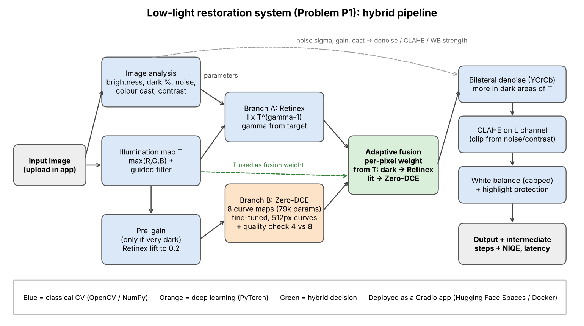

# Design Document – P1: Robust Low-Light Image Restoration and Enhancement

Team: APex decs  |  Anish Gowda P (1RUA24CSE0049), Anchit Tushar Bhatt (1RUA24CSE0049), Amith S (1RUA24CSE0038), Chethan Chouhan (1RUA24CSE0104)  |  Hackathon: Computer Vision Hackathon 2026

## 1. Problem

Photos taken at night or in dark rooms are dark, noisy and often have a colour cast.
If we just increase brightness, the noise also gets bigger, bright lamps become pure
white and colours look wrong. The task is to build a system that brightens the image
"intelligently": it should look at each image, decide how much to brighten, remove
noise and fix colour, without halos or over-exposure.

## 2. Our idea in one line

Run a classical Retinex method and a small deep learning model (Zero-DCE) side by side,
then mix their results pixel by pixel using the illumination map: the darkest areas take
the Retinex result, the lit areas take Zero-DCE. All strengths come from measurements on
the input image.

## 3. Pipeline

### 3.1 Image analysis (adaptive parameters)
We measure six numbers from the input:

| Measure | How | Used for |
|---|---|---|
| mean brightness | mean of luminance | brightening target, pre-gain on/off |
| dark ratio | % of pixels below 0.1 | reported in app |
| noise sigma | wavelet estimate (`skimage.estimate_sigma`) | denoise strength, CLAHE clip |
| colour cast | how far R, G, B means are from grey | white balance strength |
| non-uniformity | std / mean of a very blurred luminance | reported in app |
| contrast | 95th minus 5th percentile | CLAHE clip |

Noise gets amplified roughly by `target / mean brightness`, so the denoise strength is
`noise sigma x that gain x 6` (clipped to 0..1). This way a clean, bright image gets
almost no smoothing and a dark, noisy one gets strong smoothing.

### 3.2 Illumination estimation (classical)
Retinex theory says an image = reflectance (the real colours) x illumination (the light).
We estimate the illumination T like the LIME paper: take max(R, G, B) for every pixel,
then smooth it with a guided filter that uses the image itself as the guide. The guided
filter keeps edges between bright and dark objects, which is what stops halos.
We wrote the guided filter ourselves with box filters (15 lines), so no extra library.

### 3.3 Retinex enhancement (classical branch)
We change the light, not the colours: `output = I x T^(gamma - 1)`.
gamma is chosen so the mean of the new light `T^gamma` hits a target (0.45, or 0.38 for
extremely dark photos so we do not just show noise). A floor of 0.02 on T stops black
pixels from blowing up.

### 3.4 Zero-DCE (deep learning branch)
Zero-DCE (CVPR 2020) predicts 8 per-pixel curves instead of an image. Each curve is
`x + r(x^2 - x)`, which is smooth and stays inside 0..1, so colours rarely go strange.
The model has only 79,416 parameters. What we added:

* **Fine-tuning** on LOL-v2 Train (Section 6). Validation PSNR went from 13.23 dB
  (original weights) to 14.58 dB.
* **Fast inference**: curves are predicted on a copy resized to max 512 px, then
  upsampled and applied on the full image.
* **Quality-aware output**: the model gives a result after 4 curves and after 8 curves.
  We keep the one whose brightness is closest to 0.5 with the fewest clipped pixels.
* **CPU fix**: `torch.set_flush_denormal(True)` made one 512 px image go from 13.6 s to
  0.37 s on our CPU. Without it the app would be too slow.

### 3.5 Pre-gain (hybrid)
Zero-DCE was trained on images that are dark but not black. When the mean brightness is
below 0.10 we first lift the image a little with the Retinex map (target 0.20) and give
that to Zero-DCE. This is where classical illumination estimation directly helps the
deep model.

### 3.6 Adaptive fusion (hybrid)
Each pixel gets a Zero-DCE weight `w = clip(T / t_high, 0, 1)`, smoothed with a Gaussian
(sigma 5) so there are no seams. Output = `w x ZeroDCE + (1 - w) x Retinex`.
So in the darkest parts of the photo (T near 0) we trust the Retinex branch, and in parts
that already have some light we trust Zero-DCE. The app shows this weight map.

We did not guess this rule. We first tried four rules on the validation part of our own
darkened photos (60 pairs):

| Fusion rule (first validation set, 60 pairs) | PSNR (dB) | SSIM |
|---|---|---|
| exposure-fusion weights (Mertens), our first try | 16.72 | 0.579 |
| fixed 50/50 average | 17.24 | 0.596 |
| inverse-noise weighting | 17.26 | 0.598 |
| **weight from illumination T** | **17.48** | **0.614** |

The first try (well-exposedness x contrast weights) did worst because Zero-DCE's output
is noisier, and noise looks like "contrast", so the weights went to the noisy branch.
Looking at the best mix per image showed that Zero-DCE is weak in the darkest regions,
which gave us the idea to use T directly.

With the official data, `scripts/tune_fusion.py --official` re-picks t_high and the CLAHE
strength on the 158 LOL-v2 validation pairs (score = PSNR + 10 x SSIM):

| Setting (LOL-v2 validation, 158 pairs) | PSNR (dB) | SSIM |
|---|---|---|
| fixed 50/50 average | 14.60 | 0.502 |
| T weight, t_high = 0.2 | 14.61 | 0.514 |
| T weight, t_high = 0.3 | 14.45 | 0.512 |
| T weight, t_high = 0.6 | 14.11 | 0.507 |
| t_high = 0.2, CLAHE off | 14.44 | 0.530 |
| **t_high = 0.2, CLAHE scale 0.35 (chosen)** | **14.72** | 0.529 |
| t_high = 0.2, CLAHE scale 0.7 | 14.61 | 0.514 |

The chosen values are saved in `weights/fusion_config.json` and read by the app.
Full log: `results/tune_fusion_official.txt`.

### 3.7 Post-processing
* **Denoising**: bilateral filter in YCrCb, stronger on colour channels (chroma noise
  looks worst). The result is mixed back using T: dark areas, which were amplified most,
  get full denoising; bright areas keep their original detail.
* **CLAHE** on the L channel of LAB only, so colours do not shift. Clip limit is lower
  for noisy images because CLAHE also boosts noise. In the hybrid the clip limit is scaled
  by 0.35 (chosen on validation), because both branches already add contrast.
* **Colour**: grey-world white balance, but only partially (capped at 0.3) and only when
  the cast is strong. Then a soft knee above 0.85 so lamps fade to white smoothly instead
  of clipping.

## 4. Why these choices

| Choice | Reason | Alternative we did not pick |
|---|---|---|
| Zero-DCE | tiny (79k parameters), runs on CPU, does not need paired data, curves cannot create fake colours | EnlightenGAN / RetinexNet: much bigger, GAN can hallucinate textures |
| Guided filter for T | edge aware, fast, easy to explain | Gaussian blur (halos), optimisation like LIME (slow) |
| Bilateral denoise | asked in the problem, fast | Non-local means (better but slower), BM3D (too slow) |
| Fusion weight from T | simple, explainable, best on validation | Mertens exposure fusion (followed noise), a learned fusion network (needs more data and time) |
| Gradio app | quick to build, works on phone, free hosting on Hugging Face | Flask + custom front end |

## 5. Data

Main data: the official **LOL-v2** dataset (Kaggle, tanhyml/lol-v2-dataset), as given by
our faculty. LOL v1 was also downloaded for an extra test. MIT-Adobe FiveK was not used: it
has no paired dark images (only expert retouches of normal photos) and is about 50 GB.

| Set | Images | Use |
|---|---|---|
| LOL-v2 Real_captured Train + Synthetic Train | 689 + 900 = 1,589 pairs | 90% fine-tune, 10% (158) validation |
| LOL-v2 Real_captured Test | 100 pairs | main test |
| LOL-v2 Synthetic Test | 100 pairs | test |
| LOL v1 eval15 | 15 pairs | extra test (some scenes may overlap LOL-v2 Real train) |
| DICM, LIME, RetinexNet samples | 26 real dark photos, no ground truth | NIQE |

The validation split is random (seed 0) and saved in `data/official_val.json`. The test
sets were never used to train or to pick any setting.

Before we had the official data, we built our own paired set by darkening clean photos in
linear light with shot and read noise and a colour cast (`scripts/make_dataset.py`:
CBSD68 for train/val, Kodak24 + McMaster for test). The first design decisions (the
fusion rule, the white-balance cap) were made on that set; the official LOL-v2 results are
the ones we report as final.

## 6. Training

`scripts/finetune_zerodce.py --train_dir LOL-v2/Real_captured/Train --train_dir
LOL-v2/Synthetic/Train`: start from the original Zero-DCE weights, Adam, lr 2e-4, 15 epochs,
128 px random crops, batch 8, about 90–150 s per epoch on a MacBook CPU. Loss = Zero-DCE's
four zero-reference losses (spatial consistency, exposure at 0.5, colour constancy, curve
smoothness) + 20 x L1 to the ground truth. The best validation epoch (6) is saved.

## 7. Evaluation

Main result on the official LOL-v2 Real test set (100 pairs): **hybrid PSNR 19.63 dB /
SSIM 0.761 / LPIPS 0.230**, classical 18.02 / 0.673 / 0.286, Zero-DCE alone 18.12 / 0.580 /
0.313. On LOL v1 eval15 the hybrid scores 18.37 dB, on LOL-v2 Synthetic 16.95 dB (equal to
fine-tuned Zero-DCE).

See `eval_P1_TXX.md` for all numbers, `ABLATION_AND_FAILURES.md` for ablation and failure
cases. Metrics: PSNR, SSIM, LPIPS (AlexNet), CIEDE2000 colour error, edge correlation,
remaining noise, over-exposed pixels, NIQE on real photos and latency.

## 8. Deployment

Gradio app (`app.py`) hosted on Hugging Face Spaces (CPU). Images larger than 1280 px are
resized so the answer comes in a few seconds. Error messages for no image or a too small
image. A Dockerfile is included for any other host.

## 9. Limitations

* Fine-tuning on mixed Real + Synthetic LOL-v2 made Zero-DCE alone worse on Real photos
  (18.12 → 15.58 dB). Inside the hybrid it makes no difference, but a Real-only validation
  set would be the right fix.
* On LOL-v2 Synthetic the hybrid adds nothing over Zero-DCE, and NIQE on real photos
  slightly prefers the classical output.
* Grey-world white balance can still change scenes that really are one colour (sunset,
  neon). We capped it, but it is not solved.
* Bilateral filtering smooths fine texture like grass when the noise is very high.
* Zero-DCE has a non-commercial licence, so this project is for research/education.

## 10. Ethics and responsible use

* Enhanced images should not be used as evidence (for example in court or by police)
  without saying they were processed: the denoising and fusion change pixel values and
  can remove or soften small details.
* We do not store uploaded images. The app processes them in memory only.
* Datasets used (LOL-v2, LOL, DICM, LIME, CBSD68, Kodak24, McMaster) are public research sets.
