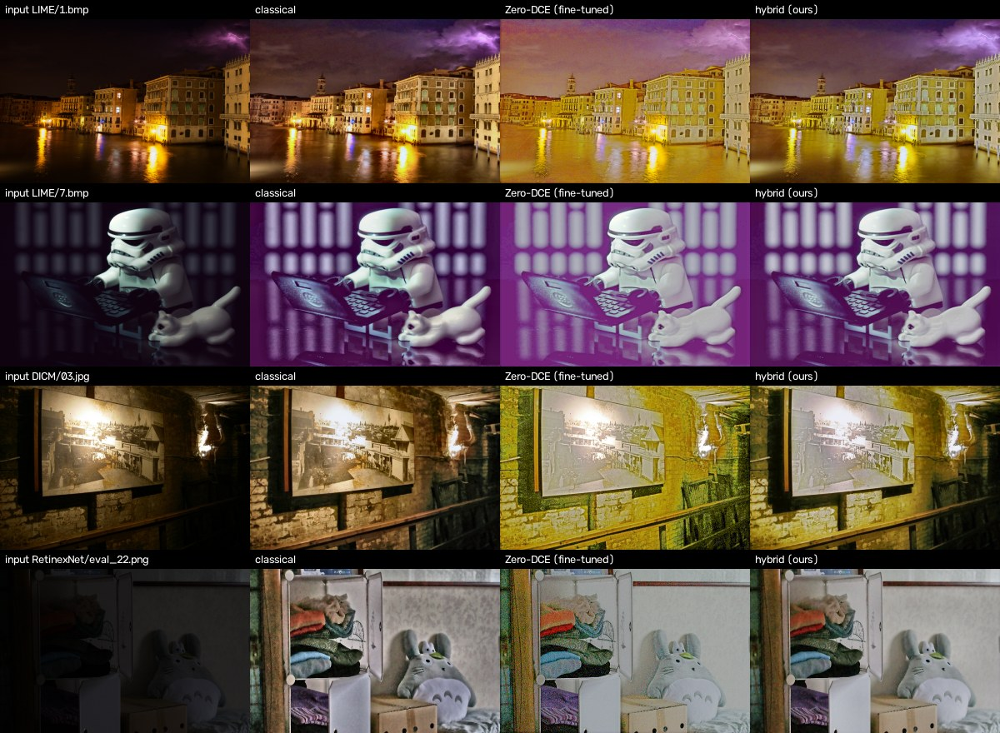
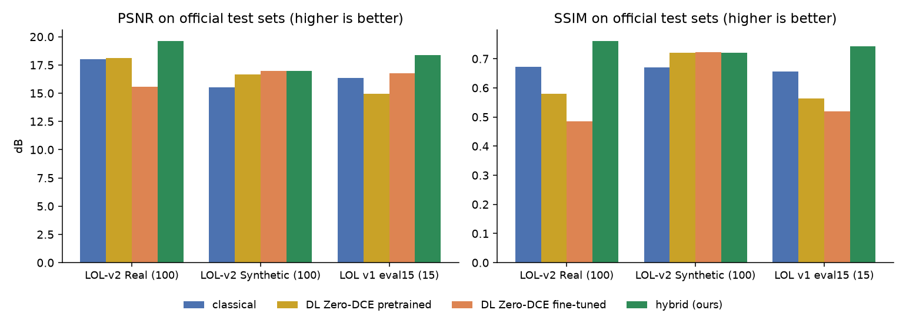
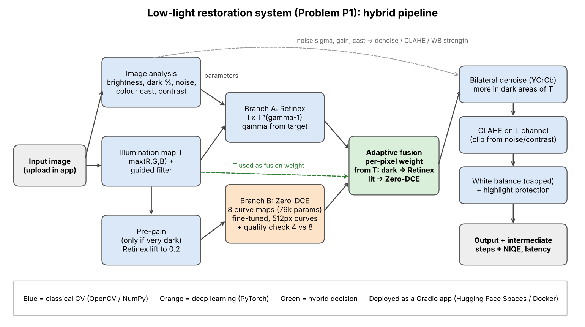
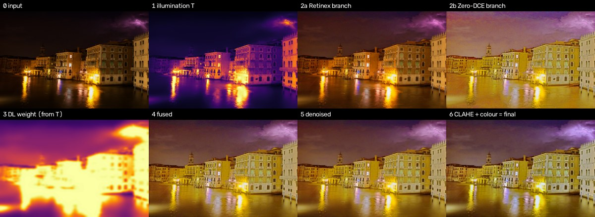

# Low-Light Image Restoration (Problem P1) – Team APex decs

**Live app:** (add link after deployment)
**Members:** Anish Gowda P (1RUA24CSE0049), Anchit Tushar Bhatt (1RUA24CSE0049), Amith S (1RUA24CSE0038), Chethan Chouhan (1RUA24CSE0104)

**Report:** [Hackathon_Solution_Report.md](Hackathon_Solution_Report.md)

Dark, noisy photos go in, a brighter and cleaner photo comes out. We combine a classical
Retinex method with a small deep learning model (Zero-DCE) and mix them per pixel using
the estimated illumination: the darkest areas use the Retinex result, the lit areas use
Zero-DCE. Then we denoise, apply CLAHE and fix colour. Every strength is chosen from the
image itself.



## Results (official LOL-v2 Real test set, 100 pairs)

| Method | PSNR (dB) ↑ | SSIM ↑ | LPIPS ↓ | Over-exposed % ↓ | Time (ms, laptop CPU) |
|---|---|---|---|---|---|
| Classical only | 18.02 | 0.673 | 0.286 | 0.000 | 69 |
| Deep learning only (Zero-DCE, original weights) | 18.12 | 0.580 | 0.313 | 0.013 | 380 |
| **Hybrid (ours)** | **19.63** | **0.761** | **0.230** | **0.000** | 447 |

Also tested on LOL-v2 Synthetic (hybrid 16.95 dB, equal to Zero-DCE fine-tuned 16.98) and
LOL v1 eval15 (hybrid 18.37 dB, classical 16.37). Full numbers:
[eval_P1_TXX.md](eval_P1_TXX.md). Ablation and failure cases:
[ABLATION_AND_FAILURES.md](ABLATION_AND_FAILURES.md). Design: [DESIGN.md](DESIGN.md).



## Architecture



What each step does is shown live in the app ("Intermediate steps"):



## Run it

**Option 1 – one command with Docker**
```
docker build -t lowlight . && docker run -p 7860:7860 lowlight
```
then open http://localhost:7860

**Option 2 – Python 3.10+**
```
pip install -r requirements.txt
python app.py
```

**Option 3 – a folder of images from the command line**
```
python run_inference.py --input_dir ./samples/ --output_dir ./results/
```
Add `--method classical` or `--method dl` to compare, and `--save_steps` to save the
illumination map, both branches and the fusion weight map.

## Reproduce the results

Download LOL-v2 (Kaggle: tanhyml/lol-v2-dataset) into `LOL-v2/` and, optionally, LOL v1
(daooshee.github.io/BMVC2018website) into `LOLdataset/`. Then:
```
pip install -r requirements.txt matplotlib
sh scripts/run_official.sh LOL-v2 LOLdataset     # ~1 hour on a laptop CPU
python scripts/make_figures.py                   # figures -> docs/
```
`run_official.sh` fine-tunes Zero-DCE on LOL-v2 Train (10% kept for validation), picks the
fusion and CLAHE settings on that validation part (saved to `weights/fusion_config.json`),
evaluates on the official test sets and runs the ablation.

Our earlier experiments on our own darkened photos (Kodak24, McMaster, CBSD68) can be
re-run with `python scripts/make_dataset.py` and the same scripts without `--test_dir`.

## Project layout

```
app.py                    Gradio web app
run_inference.py          enhance a whole folder from the command line
src/classical.py          analysis, illumination map, Retinex, bilateral, CLAHE, colour
src/zerodce.py            Zero-DCE network + quality-aware output
src/hybrid.py             hybrid pipeline and fusion
src/metrics.py            PSNR, SSIM, LPIPS, NIQE, ΔE, edge and noise measures
scripts/                  dataset, fine-tuning, tuning, evaluation, ablation, figures
weights/                  zerodce_pretrained.pth (original), zerodce_finetuned.pth (ours)
results/                  csv files and logs from our runs
docs/                     diagram and figures
```

## Data

| Data | Use | Source |
|---|---|---|
| LOL-v2 Real_captured + Synthetic, Train (1,589 pairs) | 1,431 fine-tuning, 158 validation | Kaggle tanhyml/lol-v2-dataset |
| LOL-v2 Real_captured Test (100) | main test | same |
| LOL-v2 Synthetic Test (100) | test | same |
| LOL v1 eval15 (15) | extra test | daooshee.github.io/BMVC2018website |
| DICM, LIME, RetinexNet samples (26 real dark photos) | NIQE only (no ground truth) | Zero-DCE and RetinexNet repos |
| CBSD68, Kodak24, McMaster | our earlier darkened-photo experiments | github.com/cszn/FFDNet |

The datasets are not in this repo (too large); see Reproduce. MIT-Adobe FiveK was not used:
it has no paired dark images, and it is about 50 GB.

## Limitations

* Fine-tuning Zero-DCE on mixed Real + Synthetic data made it worse on Real photos; inside
  the hybrid this does not matter, but a Real-only validation would fix it.
* On LOL-v2 Synthetic the hybrid is no better than Zero-DCE alone.
* NIQE on real dark photos slightly prefers the classical output.
* Very bright scenes come out too grey, extreme darkness leaves colour noise, and scenes
  that really are one colour can be shifted by white balance.

## Ethics

Enhanced images change pixel values (denoising can remove small details), so they should
not be used as evidence without saying they were processed. The app does not store
uploaded images. Zero-DCE code and weights are for non-commercial use only (their
licence), so this project is for education and research.

## Credits

* Zero-DCE: Guo et al., "Zero-Reference Deep Curve Estimation for Low-Light Image
  Enhancement", CVPR 2020. Code and weights: github.com/Li-Chongyi/Zero-DCE
* LIME illumination idea: Guo, Li, Ling, "LIME: Low-Light Image Enhancement via
  Illumination Map Estimation", IEEE TIP 2017
* Guided filter: He, Sun, Tang, ECCV 2010
* NIQE implementation adapted from BasicSR (Apache-2.0)
